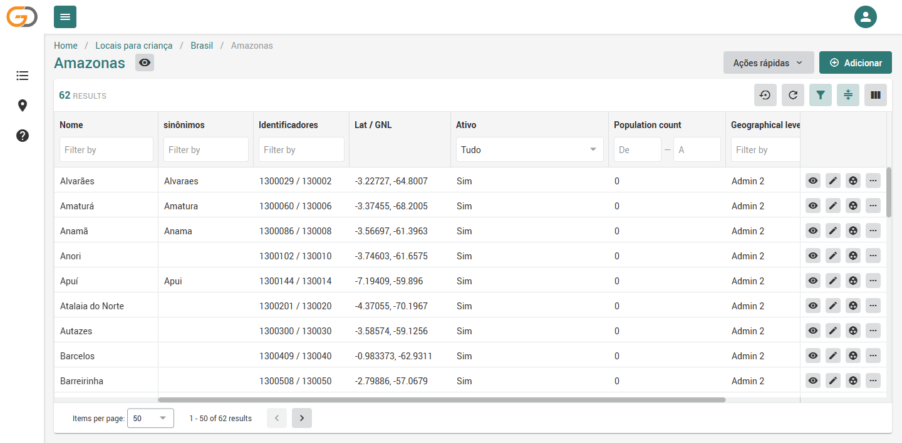

# godata-br

> **English:** Brazilian reference data for WHO's [Go.Data](https://www.who.int/tools/godata). It provides a ready-to-import location tree (27 states and 5,571 municipalities, with IBGE and SINAN codes) and an indigenous health districts tree (34 DSEIs), validated on Go.Data 2.50.3. It also includes a Docker setup that builds Go.Data from source. The documentation below is in Portuguese.

Dados de referência e ferramentas brasileiras para o [Go.Data](https://www.who.int/tools/godata), a ferramenta da OMS para investigação de surtos e rastreamento de contatos.

O Brasil é o maior usuário do Go.Data na América Latina. São cerca de 15 estados com servidor próprio, mais o servidor nacional do Ministério da Saúde, em uso desde 2024. Cada servidor precisa carregar uma árvore de localidades antes de criar o primeiro surto, e o Go.Data não vem com nenhuma. Este repositório entrega essa árvore pronta para importar.

## Arquivos de localidades (`dist/`)

| Arquivo | Conteúdo | Registros |
|---|---|---|
| `brasil-uf-municipios.json` / `.csv` | Brasil → 27 UFs → 5.571 municípios (IBGE) | 5.599 |
| `brasil-dsei-polos-base.json` / `.csv` | Raiz DSEI → 34 DSEIs → 158 Polos Base (CNES) | 193 |

Cada localidade traz:

- **Código IBGE de 7 dígitos** e **IBGE6 (6 dígitos, o código usado pelo SINAN)** como identificadores. Assim é possível casar notificações do SINAN com localidades do Go.Data sem tabela de conversão.
- Coordenadas da sede municipal. Nas UFs, o centroide.
- Nome sem acento como sinônimo (`Amaturá` → `Amatura`) e a sigla, no caso das UFs.
- IDs estáveis (`br-uf-13`, `br-mun-1302603`, `br-dsei-yanomami`, `br-polo-<CNES>`). Uma nova importação atualiza os registros em vez de duplicá-los, e outros sistemas podem referenciar esses IDs.

Os arquivos `.json` usam o formato de importação hierárquica do Go.Data. Os `.csv` seguem as colunas dos modelos em Excel da OMS (`NAME, ID, CODE, LONG, LAT, ADMIN_LEVEL, PARENTLOCATIONID`).

### Árvore DSEI: escopo e limitações

- **Incluídos:** os 34 DSEIs (SESAI/MS) e todos os Polos Base ativos cujo cadastro no CNES identifica o DSEI. São 158 dos cerca de 350 Polos Base ativos no CNES.
- **Fora desta versão:** os demais Polos Base. No CNES eles aparecem com um mantenedor genérico ("MINISTERIO DA SAUDE"), o que não permite saber o DSEI com segurança. A tabela oficial DSEI ↔ Polo Base fica no SIASI.
- **DSEIs sem nenhum Polo Base identificado por enquanto:** Altamira, Kaiapó do Mato Grosso, Minas Gerais e Espírito Santo, Parintins e Vale do Javari.
- **Coordenadas:** alguns Polos Base têm coordenadas repetidas, porque o CNES usa a sede do município como valor provisório.

## Como importar

**Pela interface:** Localidades → Ações rápidas → Importar → escolha o arquivo `.json`.

**Pela API:**

```bash
curl -X POST "https://<servidor>/api/locations/import?access_token=<token>" \
     -F "file=@dist/brasil-uf-municipios.json;type=application/json"
```

Validado no Go.Data **2.50.3**. A árvore do Brasil completa leva cerca de 2 minutos para importar, e a de DSEIs cerca de 7 segundos.

> **Atenção:** o usuário padrão `admin@who.int` (perfil System administrator) **não consegue importar localidades**. Ele não tem a permissão `location_import` e também não pode alterar os próprios perfis. Crie um usuário com o perfil **Reference data manager** e faça a importação com ele.



## Como regenerar os arquivos

```bash
python src/build_locations.py
```

O script lê os dados de `data/raw/`, que não é versionado:

- [API de localidades do IBGE](https://servicodados.ibge.gov.br/api/docs/localidades): `ibge_estados.json` e `ibge_municipios.json` (`?view=nivelado`)
- [kelvins/municipios-brasileiros](https://github.com/kelvins/municipios-brasileiros) (licença MIT): `estados.csv` e `municipios.csv`, para as coordenadas
- [CNES no OpenDataSUS](https://s3.sa-east-1.amazonaws.com/ckan.saude.gov.br/CNES/cnes_estabelecimentos.zip): `cnes_estab.zip`

## Rodando o Go.Data localmente (Docker)

A OMS não publica uma imagem Docker oficial. A pasta `docker/` compila o Go.Data a partir do código-fonte oficial:

```bash
git clone --depth 1 https://github.com/WorldHealthOrganization/GoDataSource-API vendor/GoDataSource-API
git clone --depth 1 https://github.com/WorldHealthOrganization/GoDataSource-FrontEnd vendor/GoDataSource-FrontEnd
cd docker && docker compose up -d --build   # http://localhost:8000  (admin@who.int / admin)
```

Na primeira execução o banco é inicializado e migrado, o que leva alguns minutos.

## Diagnóstico da tradução para português (versão oficial 2.50.3)

O idioma "Português" (`portuguese_pt`) que acompanha a versão oficial está incompleto:

- **5.589 de 9.785 textos (57%) são idênticos ao inglês.** Cerca de 4.800 deles são textos da interface, não da ajuda.
- **548 textos foram copiados do espanhol**, como "Registro de auditoría" e "nube".
- Há traduções erradas. O título da página de localidades aparece como "Locais para criança", e a coluna de coordenadas como "Lat / GNL".
- O vocabulário segue o português europeu ("contacto", "utilizador", "registo").

A lista completa está em `analysis/pt-traducao-pendente.csv`.

## Licença

Código: Apache-2.0. Dados: derivados do IBGE, do CNES/OpenDataSUS e de kelvins/municipios-brasileiros (MIT). Consulte os termos de cada fonte.
